## Ход работы
### Что и зачем.....?

Высокая доступность (HA) для PostgreSQL нужна, чтобы база данных оставалась доступной и работоспособной даже при сбоях оборудования, сетевого оборудования, проблемах с питанием или ошибках в работе самого сервера. 


Без HA-решений отказ основного сервера PostgreSQL приводил бы к полной остановке работы приложения. Для критически важных систем (финансовые транзакции, онлайн-платежи, системы резервирования) даже кратковременный простой может привести к серьёзным финансовым потерям или репутационному ущербу.


### 1. Сборка и запуск кластера

Работа выполнялась на локальной машине.

Кластер собирается и запускается одной командой:

``` bash
    docker compose up -d --build
```

В результате поднимаются 4 контейнера:

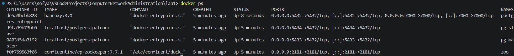

Все контейнеры находятся в статусе `Up`: PostgreSQL-мастер, PostgreSQL-слейв, Zookeeper и HAProxy.

### 2. Проверка статуса кластера

Статус кластера смотрим командой:

``` bash
    docker exec -it pg-master patronictl -c /postgres0.yml list
```

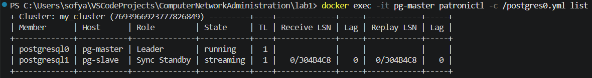

Из вывода видно, что нода `postgresql0` (pg-master) стала **Leader** в состоянии `running`, а нода `postgresql1` (pg-slave) - **Sync Standby** в состоянии `streaming`. Lag = 0, то есть слейв полностью синхронизирован с мастером.

### 3. Проверка репликации

Подключаемся к мастеру:

``` bash
    docker exec -it pg-master psql -h localhost -p 5432 -U postgres
```

Создаем тестовую таблицу и вставляем строку:

``` sql
    CREATE TABLE my_first_replication (
        id int,
        my_data varchar,
        my_comment varchar
    );

    INSERT INTO my_first_replication VALUES (1, 'my important data', 'is this line replicated?');

    SELECT * FROM my_first_replication;
```

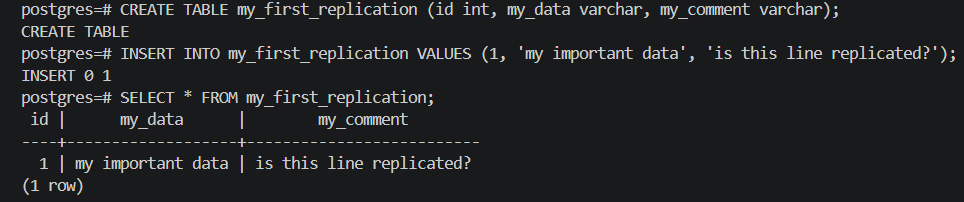

Теперь подключаемся к слейву и проверяем, что данные скопировались:

``` bash
    docker exec -it pg-slave psql -h localhost -p 5432 -U postgres
```

``` sql
    SELECT * FROM my_first_replication;
```

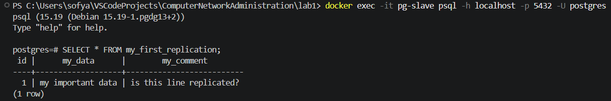

Данные идентичны - репликация работает.

Пробуем записать данные на слейв:

``` sql
    INSERT INTO my_first_replication VALUES (2, 'data on slave', 'should fail');
```

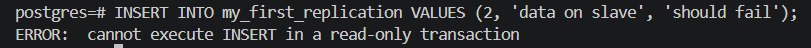

Получаем ошибку `cannot execute INSERT in a read-only transaction`. Слейв доступен только для чтения - это ожидаемое поведение при потоковой репликации.

### 4. Проверка через HAProxy

HAProxy слушает порт 5432 и автоматически направляет клиента на текущего мастера. Проверим это: подключаемся к базе не напрямую, а через HAProxy.

``` bash
    docker exec -it pg-master psql -h haproxy -p 5432 -U postgres
```


Проверяем, что нас перенаправило на мастера - пробуем записать данные:

``` sql
    INSERT INTO my_first_replication VALUES (3, 'data via haproxy', 'should succeed');

    SELECT * FROM my_first_replication;
```

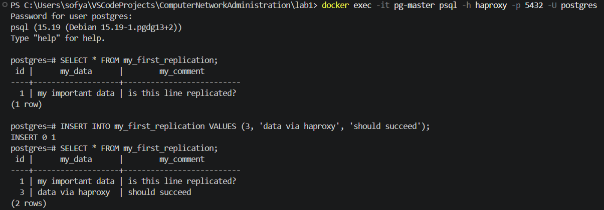

Запись прошла успешно - значит, HAProxy действительно направил нас на мастера, а не на слейв (на слейве мы бы получили ошибку read-only).

Дополнительно можно посмотреть страницу со статистикой HAProxy: http://localhost:7000

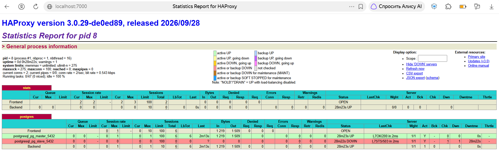

На странице видно, что сервер `postgresql_pg_master_5432` в статусе UP (зеленый), а `postgresql_pg_slave_5432` - в статусе DOWN (красный). Это не ошибка: HAProxy проверяет здоровье нод через Patroni REST API на порту 8008 и ожидает ответ HTTP 200. Patroni на лидере отвечает 200, а на реплике - 503. Поэтому HAProxy направляет трафик только на текущего лидера, а реплика для него «недоступна» - что и требуется по схеме.

### 5. Имитация отказа мастера

Это задание из методички: любым способом выключить ноду-мастера и проверить, что кластер продолжит работу.

На момент выполнения лидером является `pg-master` (нода `postgresql0`). Останавливаем его:

``` bash
    docker stop pg-master
```

После остановки Patroni на второй ноде ждет ~30 секунд (параметр `ttl: 30` в конфиге) - за это время истекает сессия лидера в Zookeeper. Затем он видит, что лидер пропал, и выставляет свою кандидатуру. Zookeeper выбирает его новым лидером, Patroni отправляет PostgreSQL команду `promote`.

Смотрим логи `pg-slave`, чтобы убедиться:

``` bash
    docker logs --tail=40 pg-slave
```

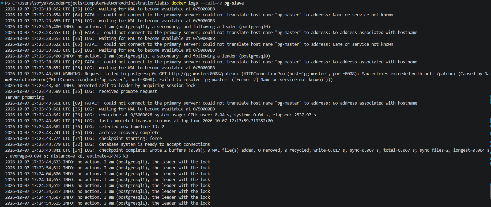

В логах видны ключевые события:
- `FATAL: could not connect to the primary server` - потеряна связь с мастером;
- `promoted self to leader by acquiring session lock` - Patroni сам себя повысил;
- `database system is ready to accept connections` - PostgreSQL переключился в режим primary;
- `I am (postgresql1), the leader with the lock` - стабильно лидер.

Проверяем статус кластера через нового лидера:

``` bash
    docker exec -it pg-slave patronictl -c /postgres1.yml list
```

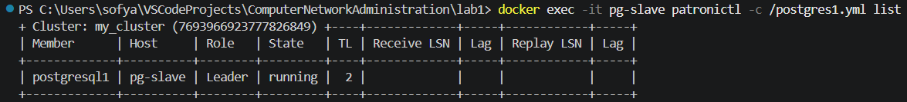

Теперь `postgresql1` (pg-slave) - **Leader**, а `postgresql0` (pg-master) вообще отсутствует в списке (он остановлен). Timeline переключился с 1 на 2 - так PostgreSQL фиксирует смену ветки истории после промоушена.

Теперь ключевая проверка: пробуем записать данные через HAProxy, пока старый мастер лежит.

``` bash
    docker exec -it pg-slave psql -h haproxy -p 5432 -U postgres
```

``` sql
    INSERT INTO my_first_replication VALUES (4, 'data after failover', 'cluster survived!');

    SELECT * FROM my_first_replication;
```

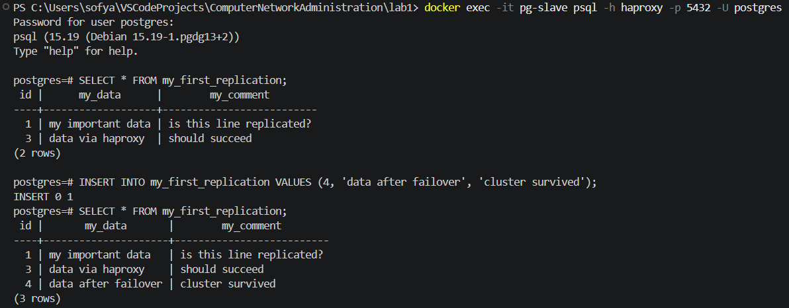

Запись **прошла успешно** (`INSERT 0 1`). В таблице теперь 3 строки. Это доказывает, что:
- HAProxy автоматически переключил трафик на нового лидера (он проверяет здоровье нод через Patroni REST API на порту 8008 каждые 3 секунды);
- кластер продолжает работать в режиме read-write, несмотря на потерю одной из нод;
- клиенту не нужно ничего менять - он все так же подключается на `haproxy:5432`.

Такое поведение называется **автоматическим failover**. Именно для этого нужны Patroni, Zookeeper и HAProxy в связке.

### 6. Возврат ноды в кластер

Запускаем ранее остановленный контейнер:

``` bash
    docker start pg-master
```

Смотрим логи вернувшейся ноды:

``` bash
    docker logs --tail=40 pg-master
```

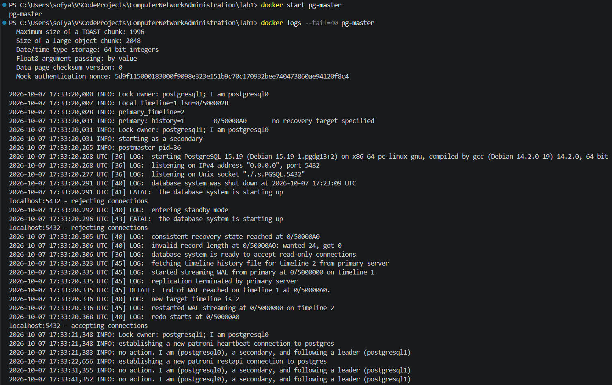

В логах видно, как Patroni на `postgresql0` корректно обрабатывает ситуацию:
- `Lock owner: postgresql1; I am postgresql0` - он видит, что лидер теперь другой;
- `primary_timeline=2` - обнаруживает, что кластер ушел на новый timeline;
- `starting as a secondary` - не пытается вернуть себе лидерство, а соглашается стать репликой;
- `restarted WAL streaming at 0/5000000 on timeline 2` - начинает стримить WAL с нового лидера и догоняет данные;
- `I am (postgresql0), a secondary, and following a leader (postgresql1)` - финальное состояние.

Никаких действий руками делать не пришлось - Patroni сам понял, что нода устарела, и синхронизировал ее с текущим лидером.

Финальная проверка статуса кластера:

``` bash
    docker exec -it pg-slave patronictl -c /postgres1.yml list
```

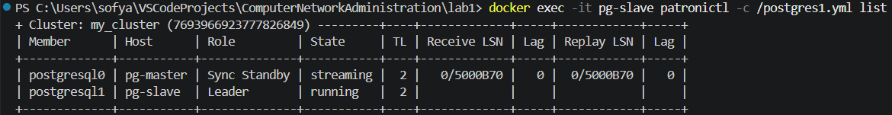

Теперь обе ноды на месте, но роли поменялись местами:
- `postgresql1` (pg-slave) - **Leader**;
- `postgresql0` (pg-master) - **Sync Standby** в состоянии `streaming`.

Patroni **не возвращает** лидерство обратно автоматически. Имя контейнера `pg-master` - это просто ярлык, он не определяет роль. Роль определяется текущим состоянием кластера в Zookeeper.

## Ответы на вопросы

### Вопрос 1. Порты 8008 и 5432 вынесены в разные директивы, expose и ports. По сути, если записать 8008 в ports, то он тоже станет exposed. В чем разница?


`expose` открывает порт **только внутри Docker-сети** - другие контейнеры могут к нему подключиться, но снаружи (с хоста) он недоступен.
`ports` пробрасывает порт **на хост-машину** - можно подключиться снаружи, например, из pgAdmin/DBeaver через `localhost:5432`.

В нашем случае:
- Порт `8008` (Patroni REST API) - только `expose`. Он нужен другим контейнерам.
- Порт `5432` (PostgreSQL) - `ports`. Нужен снаружи, чтобы подключиться из клиента.

### Вопрос 2. При обычном перезапуске композ-проекта, будет ли сбилден заново образ? А если предварительно отредактировать файлы postgresX.yml? А если содержимое самого Dockerfile? Почему?

###### При обычном перезапуске композ-проекта:

- Без флага `--build` - образ **не пересобирается**, используется закешированный.
- С флагом `--build` - образ **пересобирается** заново.
- Если поменять `Dockerfile` или файлы, указанные в `COPY` (`postgres0.yml`, `postgres1.yml`) - нужен `--build`, иначе изменения не попадут в контейнер.
- с флагом `--build --no-cache` принудительно пересборка без использования кэша (например, после очистки слоёв).

###### Если предварительно отредактировать файлы postgresX.yml:
Patroni читает конфиг при старте контейнера. В нашем случае эти файлы **копируются в образ через `COPY`**, поэтому нужен пересбор с `--build`.

###### Если поменять `Dockerfile`:
Также нужна пересборка (`--build`). Docker заново пройдет по инструкциям `RUN`, `COPY` и т.д.

Образ неизменяем, а Compose не пересобирает его автоматически при перезапуске. Любые изменения в Dockerfile или в файлах, которые копируются через COPY, попадут в контейнер только после новой сборки образа.

### Вопрос 3. Что произошло после остановки мастера?

1. Patroni на `pg-master` перестал отвечать - сессия лидера в Zookeeper истекла через ~30 секунд (параметр `ttl: 30`).
2. Patroni на `pg-slave` увидел, что лок лидера свободен, выставил свою кандидатуру и получил лок - в логах: `promoted self to leader by acquiring session lock`.
3. Patroni отправил PostgreSQL команду promote - база вышла из режима standby и стала primary. Timeline переключился с 1 на 2.
4. HAProxy при очередной проверке здоровья (каждые 3 секунды) увидел, что `pg-master` больше не отвечает `HTTP 200` на порт 8008, а `pg-slave` теперь отвечает `200`. Трафик автоматически переключился на нового лидера.
5. Клиент через HAProxy (`haproxy:5432`) даже не заметил смены - запись данных прошла успешно (`INSERT 0 1`).

**Получилось ли записать данные через entrypoint-подключение после отказа мастера?** Да, получилось. HAProxy перенаправил запрос на нового лидера, и запись прошла без ошибок.

**Что произошло после принудительного выключения мастера?** Кластер продолжил работать в режиме read-write. Смена лидера заняла примерно 30 секунд, после чего система полностью восстановила работоспособность. Это и есть High Availability в действии(одна упавшая нода не выводит сервис из строя).