# Лабораторная работа №3. Логи и метрики Nextcloud в Grafana

## Задача

Подключить к тестовому сервису Nextcloud логирование и мониторинг и вывести всё на один дашборд в Grafana:
цветная плашка со статусом сервиса и таблица с логами.

В методичке логи собираются через Promtail и Loki, а мониторинг сделан на Zabbix. Мы решили взять стек
поновее:

| Что делает | В методичке | У нас | Почему |
|---|---|---|---|
| Сервис | Nextcloud 29 | Nextcloud 35 | актуальная версия |
| Сбор логов | Promtail 2.9 | Grafana Alloy 1.21 | Promtail объявлен устаревшим (с 2025 только исправления безопасности, поддержка закончилась в марте 2026), Alloy - его замена от той же Grafana Labs |
| Хранение логов | Loki 2.9 | Loki 3.7 | |
| Мониторинг | Zabbix 6.4 + PostgreSQL + веб-интерфейс | Prometheus 3.15 + blackbox_exporter | проверка status.php делается одним экспортером, правило алерта - аналог триггера Zabbix; не нужна отдельная база и плагин для Grafana |
| Визуализация | Grafana 11 + плагин Zabbix | Grafana 13 | Prometheus и Loki поддерживаются из коробки |

Как идут данные:

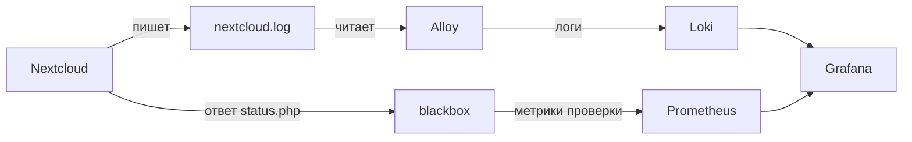

- **Логи:** Nextcloud пишет `nextcloud.log` в том `nc-data`, Alloy читает этот файл и отправляет строки в Loki.
- **Метрики:** раз в 15 секунд Prometheus обращается к blackbox, тот запрашивает `status.php` у Nextcloud
  и возвращает результат проверки как метрики (стрелки на схеме показывают, куда идут данные, а запросы
  идут в обратную сторону). Там же, в Prometheus, работает правило алерта.
- **Grafana** берёт логи из Loki, метрики из Prometheus и показывает их на одном дашборде.

---

## Часть 1. Логирование

### 1.1. docker-compose.yml

Все сервисы описаны в одном [docker-compose.yml](docker-compose.yml):

```yaml
services:
  nextcloud:
    image: nextcloud:35.0.2-apache
    container_name: nextcloud # на это имя завязана проверка в Prometheus
    environment:
      SQLITE_DATABASE: nextcloud
      NEXTCLOUD_ADMIN_USER: admin
      NEXTCLOUD_ADMIN_PASSWORD: admin-password
    ports:
      - "8080:80"
    volumes:
      - nc-data:/var/www/html/data

  loki: # хранилище логов
    image: grafana/loki:3.7.9
    container_name: loki
    ports:
      - "3100:3100"
    command: -config.file=/etc/loki/local-config.yaml # дефолтный конфиг из образа

  alloy: # сборщик логов, замена Promtail
    image: grafana/alloy:v1.21.2
    container_name: alloy
    ports:
      - "12345:12345" # веб-интерфейс Alloy
    volumes:
      - nc-data:/opt/nc_data:ro # та же директория, что монтируется в Nextcloud
      - ./alloy/config.alloy:/etc/alloy/config.alloy
    command: run --server.http.listen-addr=0.0.0.0:12345 --storage.path=/var/lib/alloy/data /etc/alloy/config.alloy

  blackbox: # проверяет status.php по HTTP
    image: prom/blackbox-exporter:v0.29.1
    container_name: blackbox
    volumes:
      - ./blackbox/blackbox.yml:/etc/blackbox_exporter/config.yml

  prometheus: # хранилище метрик и правила алертов
    image: prom/prometheus:v3.15.1
    container_name: prometheus
    ports:
      - "9090:9090"
    volumes:
      - ./prometheus/prometheus.yml:/etc/prometheus/prometheus.yml
      - ./prometheus/alerts.yml:/etc/prometheus/alerts.yml

  grafana:
    image: grafana/grafana:13.2.4
    container_name: grafana
    environment:
      - GF_AUTH_ANONYMOUS_ENABLED=true
      - GF_AUTH_ANONYMOUS_ORG_ROLE=Admin
    ports:
      - "3000:3000"
    volumes:
      - grafana-data:/var/lib/grafana

volumes:
  nc-data:
  grafana-data:
```

Отличия от методички:

- Nextcloud ставится сразу при первом запуске: переменные `NEXTCLOUD_ADMIN_USER` / `NEXTCLOUD_ADMIN_PASSWORD`
  и `SQLITE_DATABASE` делают то же, что форма установки в браузере (SQLite, как и в методичке).
- Том `nc-data` смонтирован в Alloy только на чтение: сборщику незачем менять файлы Nextcloud.
- У Grafana свой том, чтобы источники данных и дашборд не терялись при пересоздании контейнера.

### 1.2. Конфиг Alloy

Alloy настраивается не YAML-ом, а на своём языке: каждый блок - компонент, и компоненты соединяются
ссылками (`forward_to`, `targets`). Получается конвейер, как у Promtail, только связи видны явно.
Файл [alloy/config.alloy](alloy/config.alloy):

```alloy
// ищем лог-файлы Nextcloud в смонтированной директории
local.file_match "nextcloud" {
  path_targets = [{
    __path__ = "/opt/nc_data/*.log",
    job      = "nextcloud_logs",
  }]
}

// читаем найденные файлы и отправляем строки дальше
loki.source.file "nextcloud" {
  targets    = local.file_match.nextcloud.targets
  forward_to = [loki.process.nextcloud.receiver]
}

// разбираем JSON-строку: время записи и уровень
loki.process "nextcloud" {
  stage.json {
    expressions = { level = "level", time = "time" }
  }
  // время берём из самой записи, а не момент чтения файла
  stage.timestamp {
    source = "time"
    format = "RFC3339"
  }
  // Nextcloud пишет уровень числом: 0 debug, 1 info, 2 warning, 3 error, 4 fatal
  stage.template {
    source   = "level"
    template = "{{ if eq .Value \"0\" }}debug{{ else if eq .Value \"1\" }}info{{ else if eq .Value \"2\" }}warning{{ else if eq .Value \"3\" }}error{{ else }}fatal{{ end }}"
  }
  stage.labels {
    values = { level = "" }
  }
  forward_to = [loki.write.local.receiver]
}

loki.write "local" {
  endpoint {
    url = "http://loki:3100/loki/api/v1/push"
  }
}
```

Соответствие с `promtail_config.yml` из методички:

| Promtail | Alloy |
|---|---|
| `scrape_configs` → `static_configs` → `__path__`, `job` | `local.file_match` |
| чтение файлов, `positions.yaml` | `loki.source.file` (позиции хранит в `--storage.path`) |
| `pipeline_stages` | `loki.process` |
| `clients` → `url` | `loki.write` |

Блок `loki.process` в методичке не нужен, мы добавили его по двум причинам. Сначала уровень брался из лога
как есть, числом, и Grafana показала предупреждения о неудачном входе как `CRIT`: число 2 она понимает
как уровень critical из syslog, а у Nextcloud 2 - это warning. Поэтому число переводится в название.
Вторая причина - время: без `stage.timestamp` Loki ставит записи время чтения файла, и после перезапуска
сборщика все старые строки оказались бы в одной точке.

### 1.3. Запуск

```bash
podman machine start
podman compose up -d
```

```text
$ podman compose ps
CONTAINER ID  IMAGE                                      STATUS        PORTS                     NAMES
b22af011c6b4  docker.io/library/nextcloud:35.0.2-apache  Up 8 minutes  0.0.0.0:8080->80/tcp      nextcloud
98cadfd21f99  docker.io/prom/blackbox-exporter:v0.29.1   Up 8 minutes  9115/tcp                  blackbox
81d0ab99035f  docker.io/prom/prometheus:v3.15.1          Up 8 minutes  0.0.0.0:9090->9090/tcp    prometheus
fbf1825c45b7  docker.io/grafana/grafana:13.2.4           Up 8 minutes  0.0.0.0:3000->3000/tcp    grafana
4bcd56a76a76  docker.io/grafana/loki:3.7.9               Up 1 minute   0.0.0.0:3100->3100/tcp    loki
1a86d9d1dab3  docker.io/grafana/alloy:v1.21.2            Up 1 minute   0.0.0.0:12345->12345/tcp  alloy
```

Loki и Alloy пересоздавались после правки конфига Alloy (п. 1.2), поэтому они запущены позже остальных.

### 1.4. Nextcloud и его лог

Nextcloud открывается на http://localhost:8080, вход под `admin`:

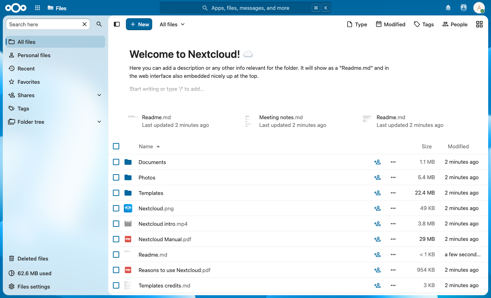

Перед этим мы специально один раз ввели неверный пароль и ещё несколько раз попробовали войти под
несуществующими пользователями, чтобы в логе были записи. Лог лежит в `/var/www/html/data/nextcloud.log`,
одна запись - одна JSON-строка:

```text
$ podman exec nextcloud tail -n 1 /var/www/html/data/nextcloud.log
{"reqId":"64PDAQPDr7PR263iONMZ","level":2,"time":"2026-10-25T14:57:34+00:00","remoteAddr":"10.89.0.2","user":"--",
"app":"no app in context","method":"POST","url":"/login","scriptName":"/index.php",
"message":"Login failed: admin (Remote IP: 10.89.0.2)", ...}
```

### 1.5. Проверка, что Alloy подхватил файл

В логах Alloy должна быть строка `start tailing file` с путём к `nextcloud.log` (у Promtail это была
строка `Seeked /opt/nc_data/nextcloud.log`):

```text
$ podman logs alloy 2>&1 | grep "start tailing"
ts=2026-10-25T15:03:29.410Z level=info msg="start tailing file" component_id=loki.source.file.nextcloud path=/opt/nc_data/nextcloud.log
ts=2026-10-25T15:03:29.411Z level=info msg="start tailing file" component_id=loki.source.file.nextcloud path=/opt/nc_data/flow.log
```

`flow.log` - пустой файл модуля Flow в Nextcloud, он тоже подходит под маску `*.log`.

У Alloy есть веб-интерфейс (http://localhost:12345), в нём виден граф конвейера из конфига:

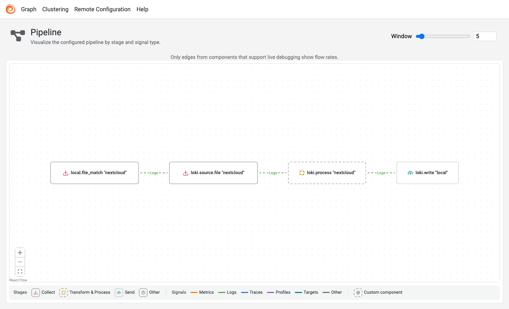

---

## Часть 2. Мониторинг

В методичке Zabbix раз в минуту запрашивает `http://nextcloud/status.php`, достаёт поле `maintenance`
и поднимает триггер, если оно `true`. В Prometheus то же самое делается так:

- **blackbox_exporter** выполняет HTTP-запрос к `status.php` и проверяет ответ. Результат - метрика
  `probe_success` (1 - проверка прошла, 0 - нет), заодно время ответа `probe_duration_seconds`
  и код ответа `probe_http_status_code`.
- **Prometheus** каждые 15 секунд опрашивает blackbox и хранит эти метрики.
- **Правило алерта** в Prometheus - аналог триггера Zabbix.

### 2.1. blackbox_exporter

[blackbox/blackbox.yml](blackbox/blackbox.yml) - модуль проверки:

```yaml
modules:
  nextcloud_status:
    prober: http
    timeout: 5s
    http:
      valid_status_codes: [200]
      fail_if_body_not_matches_regexp:
        - '"installed":true'
      fail_if_body_matches_regexp:
        - '"maintenance":true' # в режиме обслуживания проверка считается проваленной
```

В шаблоне Zabbix из методички ответ разбирался по JSONPath `$.body.maintenance` и превращался в строку
healthy/unhealthy. Здесь проверка сразу даёт число: тело ответа содержит `"maintenance":true` -
проверка провалена.

### 2.2. Prometheus

[prometheus/prometheus.yml](prometheus/prometheus.yml):

```yaml
global:
  scrape_interval: 15s
  evaluation_interval: 15s

rule_files:
  - /etc/prometheus/alerts.yml

scrape_configs:
  - job_name: nextcloud_status
    metrics_path: /probe
    params:
      module: [nextcloud_status]
    static_configs:
      - targets:
          - http://nextcloud/status.php
    relabel_configs:
      # адрес проверяемого сервиса передаём в blackbox параметром target
      - source_labels: [__address__]
        target_label: __param_target
      - source_labels: [__param_target]
        target_label: instance
      - target_label: __address__
        replacement: blackbox:9115
```

`relabel_configs` - стандартная схема для blackbox: в `targets` записан проверяемый адрес, но запрос
Prometheus отправляет на сам blackbox (`blackbox:9115/probe?module=nextcloud_status&target=http://nextcloud/status.php`),
а адрес Nextcloud оставляет в метке `instance`.

Цель видна в Prometheus (http://localhost:9090, Status → Target health):

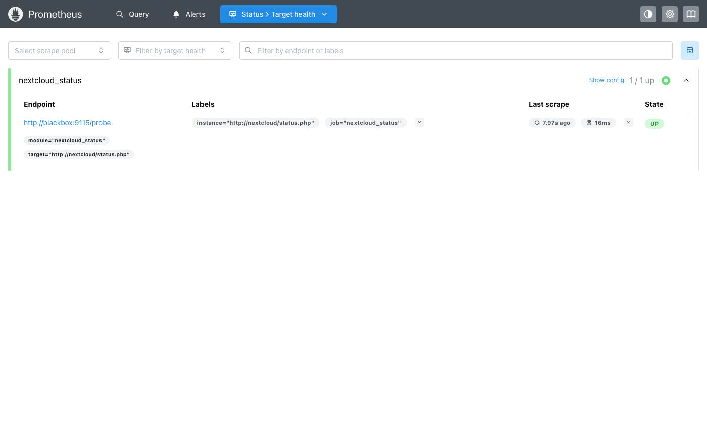

### 2.3. trusted_domains

Сразу после запуска `probe_success` был равен 0. В отладочном выводе blackbox видно почему:

```text
$ podman exec prometheus wget -qO- 'http://blackbox:9115/probe?module=nextcloud_status&target=http://nextcloud/status.php&debug=true'
level=ERROR msg="Invalid HTTP response status code" target=http://nextcloud/status.php status_code=400 valid_status_codes=[200]
level=ERROR msg="Probe failed" module=nextcloud_status target=http://nextcloud/status.php
```

Nextcloud отвечает 400 на запросы с неизвестным именем хоста, а в `trusted_domains` после установки есть
только `localhost`. Добавляем имя контейнера, как в методичке:

```text
$ podman exec -u www-data nextcloud php occ config:system:set trusted_domains 1 --value="nextcloud"
System config value trusted_domains => 1 set to string nextcloud
```

После этого `probe_success` = 1.

### 2.4. Правило алерта

[prometheus/alerts.yml](prometheus/alerts.yml):

```yaml
groups:
  - name: nextcloud
    rules:
      - alert: NextcloudUnhealthy
        expr: probe_success{job="nextcloud_status"} == 0
        for: 30s
        labels:
          severity: disaster
        annotations:
          summary: Nextcloud is in maintenance mode or unavailable
```

Сравнение с триггером Zabbix:

| Zabbix | Prometheus |
|---|---|
| `expression: last(...)="unhealthy"` | `expr: probe_success == 0` |
| `recovery_expression: last(...)="healthy"` | отдельно не пишется: алерт снимается, когда `expr` перестаёт выполняться |
| `priority: DISASTER` | метка `severity: disaster` |
| - | `for: 30s` - условие должно держаться 30 секунд, чтобы один сбойный запрос не поднимал тревогу |

Алерт срабатывает и в режиме обслуживания, и если Nextcloud вообще не отвечает. Для статуса «сервис
работает / не работает» это даже лучше: Zabbix из методички в случае падения просто перестал бы получать
данные.

### 2.5. Проверка через maintenance mode

Включаем режим обслуживания:

```text
$ podman exec -u www-data nextcloud php occ maintenance:mode --on
Maintenance mode enabled

$ curl http://localhost:8080/status.php
{"installed":true,"maintenance":true,"needsDbUpgrade":false,"version":"35.0.2.2","versionstring":"35.0.2",...}
```

Алерт сначала переходит в состояние `pending` (условие выполняется, но 30 секунд ещё не прошло),
затем в `firing`:

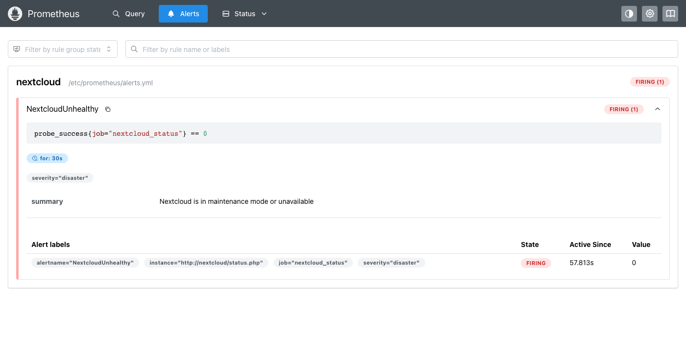

Выключаем режим:

```text
$ podman exec -u www-data nextcloud php occ maintenance:mode --off
Maintenance mode disabled
```

Через один цикл опроса алерт снимается:

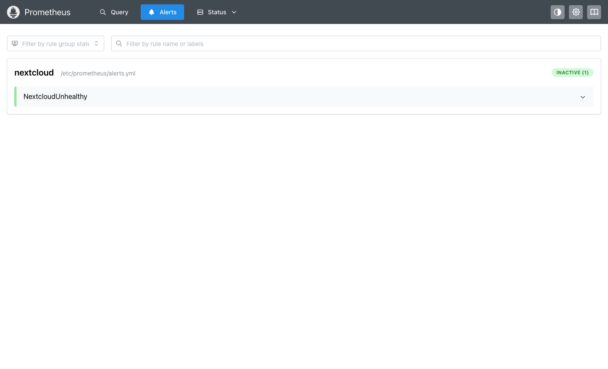

---

## Часть 3. Визуализация

### 3.1. Источники данных

Плагины ставить не нужно: Loki и Prometheus поддерживаются в Grafana из коробки.

Grafana открывается на http://localhost:3000. Connections → Data sources → Add new data source → Loki,
в поле URL - `http://loki:3100`, остальное по умолчанию:

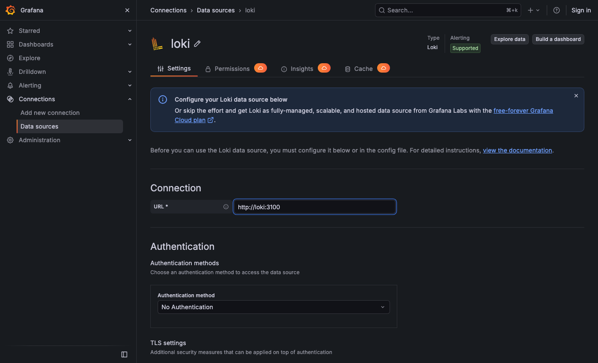

Save & test:

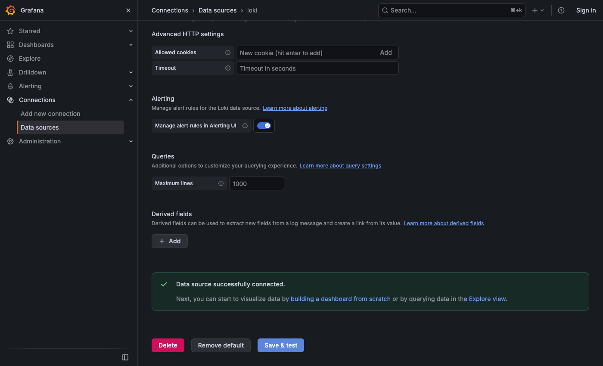

Так же добавляем Prometheus с адресом `http://prometheus:9090`:

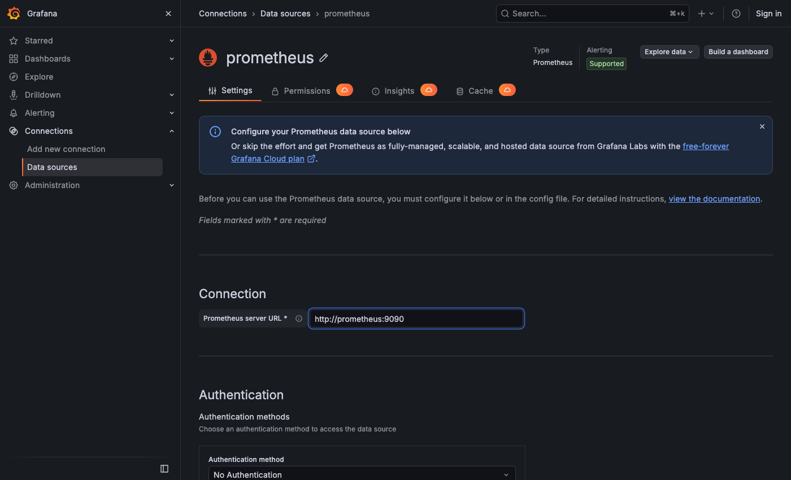

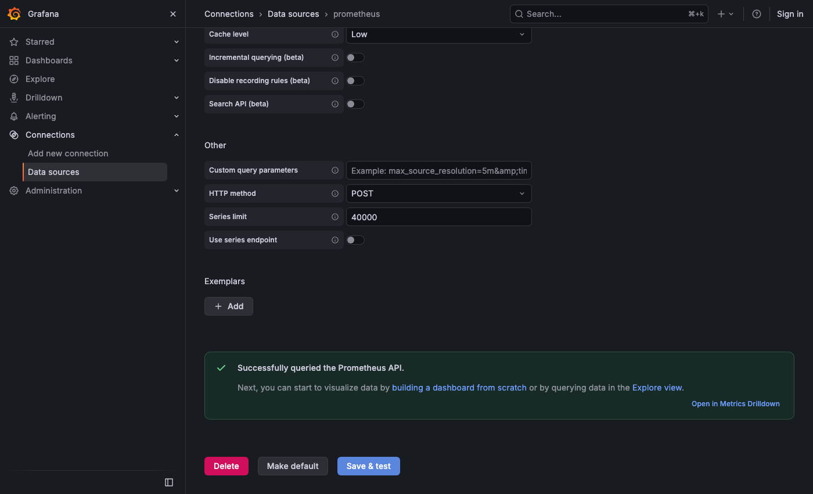

### 3.2. Запросы в Explore

**Логи.** Выбираем `job` = `nextcloud_logs`. Запрос ниже разбирает JSON прямо в запросе (`| json`)
и оставляет только неудачные входы:

```logql
{job="nextcloud_logs"} | json | message=~"Login failed.*"
```

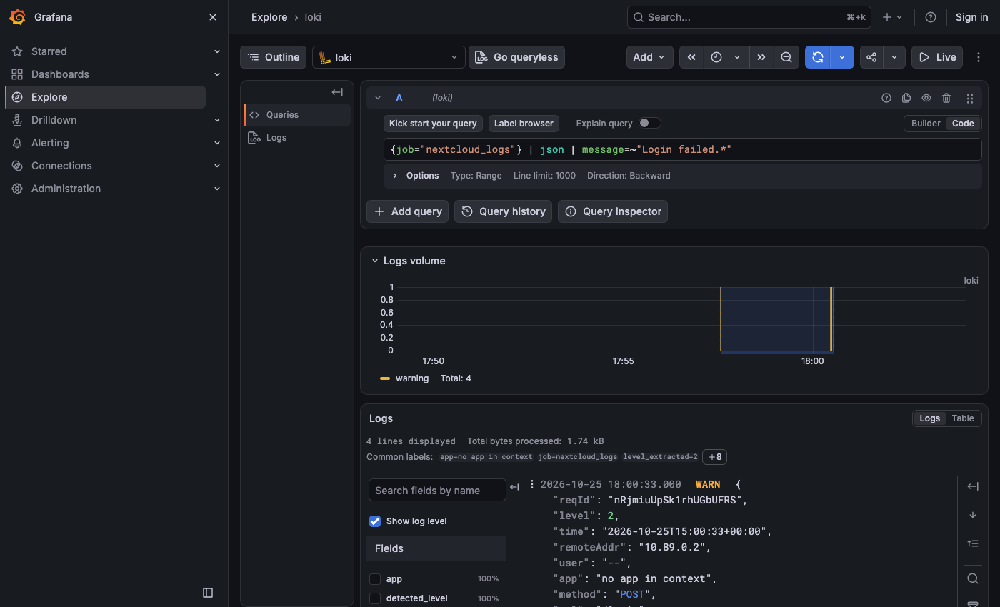

Из логов можно получить и метрику: число записей за минуту по уровням.

```logql
sum by (level) (count_over_time({job="nextcloud_logs"}[1m]))
```

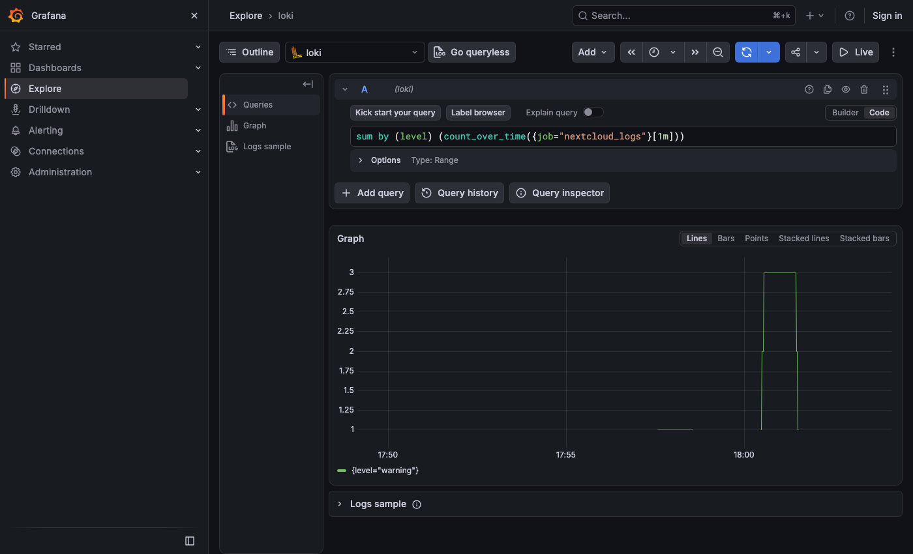

**Метрики.** Результат проверки за последние 15 минут: сначала 0 (ещё не добавлен `trusted_domains`),
потом 1, потом снова 0 во время режима обслуживания и обратно 1:

```promql
probe_success{job="nextcloud_status"}
```

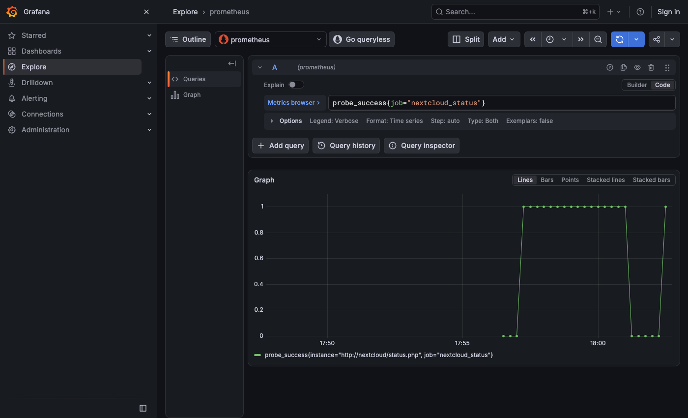

Prometheus сам записывает состояние алертов во временной ряд `ALERTS`, поэтому историю срабатываний
тоже можно посмотреть в Grafana. Видны два эпизода `pending` → `firing`: первый - сразу после запуска,
пока не был добавлен `trusted_domains`, второй - режим обслуживания:

```promql
ALERTS{alertname="NextcloudUnhealthy"}
```

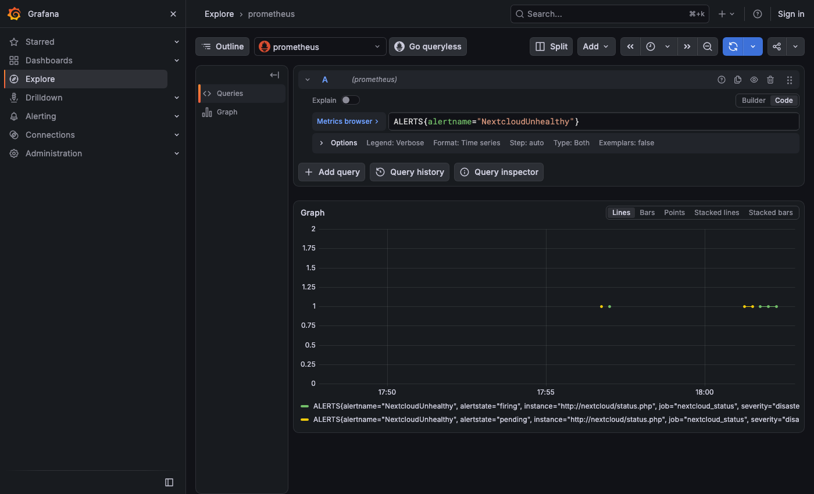

### 3.3. Дашборд

Дашборд `Nextcloud` (Dashboards → New → New dashboard), четыре панели:

| Панель | Тип | Источник | Запрос |
|---|---|---|---|
| Nextcloud status | Stat | Prometheus | `probe_success{job="nextcloud_status"}` |
| status.php response time | Time series | Prometheus | `probe_duration_seconds{job="nextcloud_status"}` |
| Log entries by level | Time series (столбцы) | Loki | `sum by (level) (count_over_time({job="nextcloud_logs"}[$__auto]))` |
| Nextcloud logs | Table | Loki | `{job="nextcloud_logs"}` |

Цветная плашка - панель Stat с цветом фона (Color mode: Background). Число 0/1 превращается в текст
через Value mappings, цвет задают те же маппинги и пороги (Thresholds: base - красный, от 1 - зелёный):

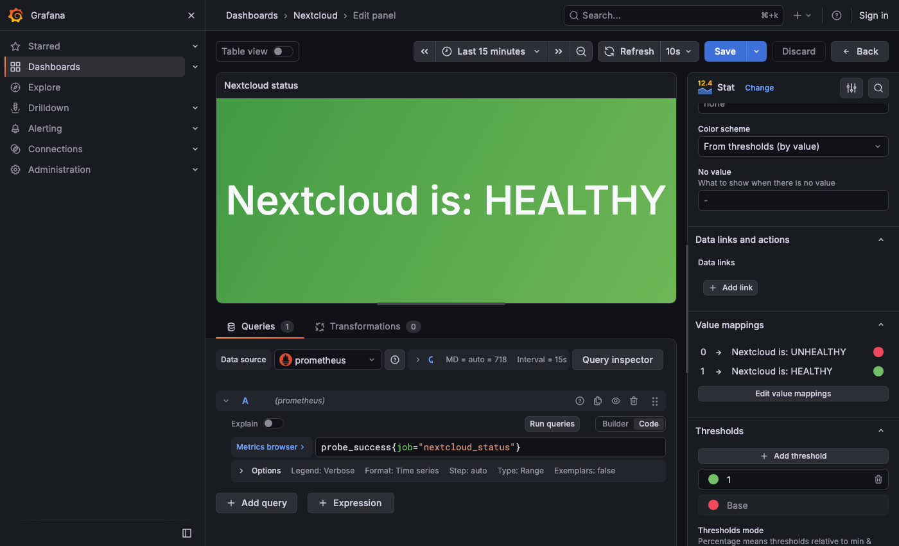

В таблице логов через трансформацию Organize fields скрыты служебные столбцы, остаются время и строка лога.

Nextcloud работает:

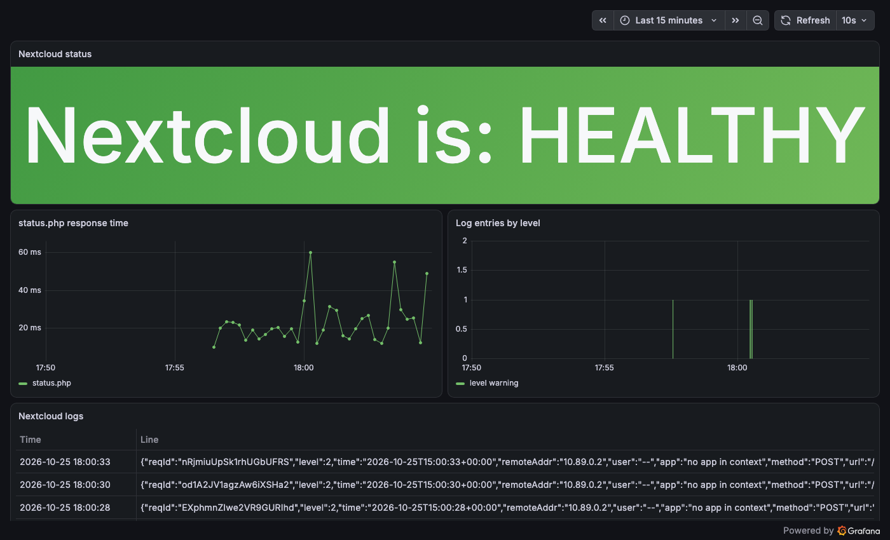

Nextcloud в режиме обслуживания:

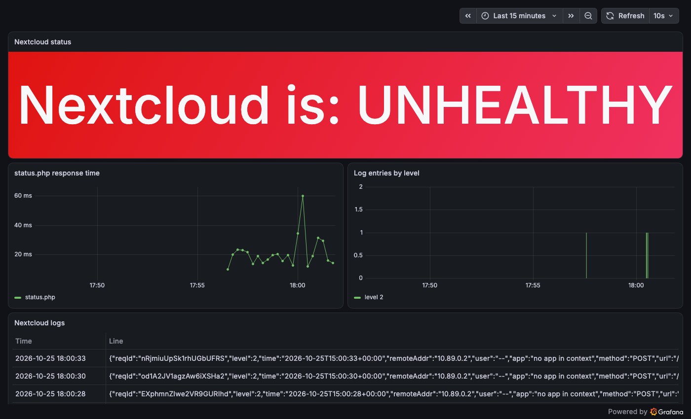

JSON-модель готового дашборда (её показывает Export → Export as code) сохранена в
[grafana/nextcloud-dashboard.json](grafana/nextcloud-dashboard.json), его можно загрузить через Dashboards → New → Import. В JSON прописаны uid наших источников данных,
поэтому на другой машине при импорте их нужно выбрать заново.

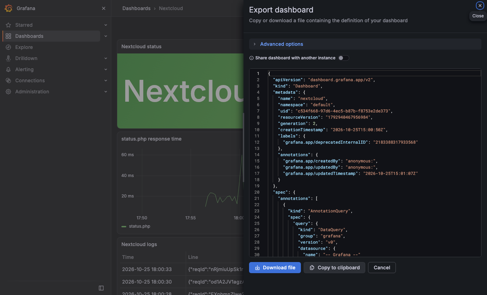

---

## Ответы на вопросы

### 1. Чем SLO отличается от SLA?

**SLI** (Service Level Indicator) - измеряемый показатель: доля успешных запросов, время ответа,
доступность. В этой работе SLI - это `probe_success`, доля успешных проверок `status.php`.

**SLO** (Service Level Objective) - внутренняя цель для SLI, которую ставит себе команда: например,
«99,9 % проверок за 30 дней успешны». Из SLO получается бюджет ошибок: при 99,9 % за 30 дней можно
простоять около 43 минут. Пока бюджет не израсходован, можно выкатывать изменения; если израсходован -
заниматься стабильностью.

**SLA** (Service Level Agreement) - договор с клиентом, где записан уровень сервиса и что будет при его
нарушении: компенсация, скидка, штраф. SLA - юридическое обязательство, SLO - инженерная цель.

Поэтому SLO обычно строже SLA (например, SLO 99,95 % при SLA 99,9 %): команда должна заметить проблему
и исправить её раньше, чем нарушится договор.

### 2. Чем отличается инкрементальный бэкап от дифференциального?

Оба начинаются с полной копии, разница в том, от чего считаются изменения.

- **Инкрементальный** сохраняет то, что изменилось с **последнего бэкапа любого типа**. Копии маленькие
  и делаются быстро. Для восстановления нужна полная копия и **вся цепочка** инкрементов после неё;
  потеря одного звена ломает всё, что идёт за ним.
- **Дифференциальный** сохраняет то, что изменилось с **последнего полного бэкапа**. С каждым днём копия
  растёт, пока не сделают новую полную. Для восстановления нужны две копии: полная и последняя
  дифференциальная.

Пример: полный бэкап в воскресенье, восстанавливаемся в четверг. Инкрементальная схема: воскресенье +
понедельник + вторник + среда + четверг. Дифференциальная: воскресенье + четверг.

Итог: инкрементальный экономит место и время копирования, дифференциальный - время и надёжность
восстановления.

### 3. В чём разница между мониторингом и observability?

**Мониторинг** отвечает на вопросы, которые заданы заранее: работает ли сервис, не превышен ли порог
по CPU, сработал ли алерт. Мы заранее знаем, что может сломаться, и следим за этим. Наша проверка
`status.php` с алертом - это мониторинг: она знает только про один сценарий отказа.

**Observability** (наблюдаемость) - свойство системы: по её внешним сигналам можно понять, что происходит
внутри, в том числе в ситуации, которую никто не предвидел. Для этого собираются метрики, логи и трассировки
(три «столпа» observability), связанные общими метками, чтобы можно было задать новый вопрос постфактум,
не меняя код и не добавляя новых проверок.

Мониторинг говорит, **что** сломалось; observability помогает понять, **почему**. Мониторинг - часть
observability. В этой работе к мониторингу добавлены логи в Loki: когда плашка красная, рядом видно,
что в это время писал Nextcloud, и логи можно фильтровать любыми запросами, не придуманными заранее.

---

## Как запустить

```bash
podman compose up -d   # или docker compose up -d
podman exec -u www-data nextcloud php occ config:system:set trusted_domains 1 --value="nextcloud"
```

| Сервис | Адрес |
|---|---|
| Nextcloud | http://localhost:8080 (admin / admin-password) |
| Grafana | http://localhost:3000 |
| Prometheus | http://localhost:9090 |
| Alloy | http://localhost:12345 |
| Loki | http://localhost:3100 |

Источники данных в Grafana добавляются по п. 3.1, дашборд импортируется из `grafana/nextcloud-dashboard.json`.
